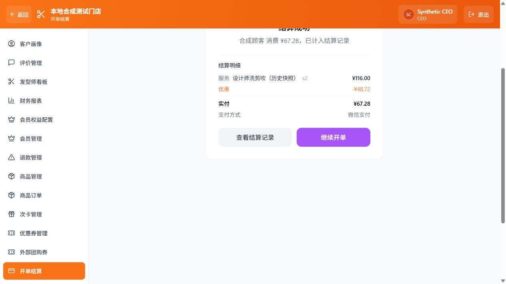

# 新建结算安全闭环与测试单清理（2026-10-24）

## 当前范围

项目主人明确：旧版“顾客0001”未完成结算均为测试数据，可删除；停止旧版人工核对恢复功能开发。本批重点是后续新建结算的金额、支付、资产核销和追溯安全。此前旧版人工核对计划终止，不新增人工确认价格入口。

## 计划与验收

1. 仅针对“顾客0001”的 pending/failed 测试结算先备份；无支付关联、未发起支付认领的记录使用已有原子删除函数清理并释放预占。已关联微信的记录另批核对/关单，不删除已完成或真实收款凭据，不清客户或预约。
2. 修复新微信开单中“结算先提交、支付映射后插入”的中断窗口：新增单一原子入口，同时保存核价后结算、权益/次卡预占和唯一支付映射；任一步失败整笔回滚。同号同请求重试恢复原支付，不重核新价或再开收款。
3. 完成页面金额与项目取服务端已完成原单；避免余额前端猜扣造成和数据库不一致。现金/银行卡实际时间与录入时间仍分开，微信只取已验签 success_time。
4. 隔离测试核对金额篡改、支付映射失败回滚、同号重试、次卡防重、重复回调、手选时间，以及创建—付款—列表查询链路；构建/后端启动/浏览器 Network 实测。

## 不在本批

不改变门店服务价、折扣、提成或角色政策；不恢复旧版订单，不删除已付收款凭据，不从本地调用真实微信下单/关单。数据库升级和代码推送仍给用户手动命令；新迁移先只读核实实际结构。

## 本批完成内容

- 040 新增 `create_wechat_settlement_atomic`：沿用现有服务端核价、预约/次卡/权益规则，把结算及支付映射放进一个数据库事务；映射插入失败时，新结算、认领、预占一起回滚，已有草稿恢复原状。只授权 service_role，明确撤销 PUBLIC、anon、authenticated。
- 相同单号、相同请求重试时优先恢复原支付，不查询当前目录重新套价；请求内容改变拒绝重复收款。支付恢复已确认微信成功时返回完成原单，避免前端把已付结果当成另一张待付款二维码。
- 成功页用数据库完成记录显示姓名、项目、折扣、金额、付款方式，记录按钮携本单号定位。余额不再前端猜扣，读取最新客户资料；读取失败不撤销已成功收款，不误提示重新结算，提醒刷新资料。
- “继续开单”清除原结算/客户/二维码/手选付款时间，防止串单及把上一单的补录时间带入下一单。
- setup-db 顺序补齐 040，保留旧安装器互斥锁以防两个版本同时升级。提供 `upgrade-atomic-checkout.ts` 单独安装 040；verify-release 自动检查新函数签名与最终执行权限（34 个函数）。

## 已执行的测试数据清理

项目主人本轮明确授权删除顾客0001的未完成测试结算。先只读盘点，共23条；其中18条没有支付映射且未认领收款，已在数据库事务中通过既有原子删除函数清理。删除前将目标记录及相关支付、项目、预占等保存到仓库外的本机私有备份；事务前后全部客户行指纹一致，相关已完成结算数量不变。

只读复核剩5条，均为顾客0001、pending、有关联微信支付，合计246.83元；本地缺少微信查单配置，未从本地查询/关闭网关或删除其支付账务映射。按主人“以后也可删除”的指示延期清理，不继续扩展旧版核价功能。这5条不代表已收款；清理不能只凭本地pending状态推断微信未付。没有删除客户、预约或已完成收款，未重置密码、余额。

## 验证记录

- 全套隔离回归111项通过。新增覆盖映射故障回滚、次卡预占恢复、原草稿保留、同号重试仅一条映射、请求/金额/归属变更拒绝、040接038恢复及037真实SQL收款、重复回调、客户端权限、升级DDL故障回滚；HTTP用合成网关验证超时后原请求在服务价格改变后仍按原金额恢复。
- 生产构建通过，新增脚本与修改测试的独立TypeScript检查通过。初次新增测试误用了不存在的visit记录列、安装器测试迁移数量未更新，均修正后全套重跑通过；未跳过失败用例。
- 本地真实后端启动，健康接口HTTP200。生产产物在独立本地端口通过隔离API验收：原快照67.28元成功页、准确定位结算记录；现金58元补录后继续开单，付款时间清空；新微信58元生成二维码、关闭后恢复同一结算。浏览器触发的创建POST201、恢复POST200、状态/详情/客户GET200均由隔离服务端日志核对，浏览器无运行错误。
- 页面验收只使用合成客户、合成微信网关；SQL测试使用PGlite，不连接生产。截图如下，不是真实收款证明。尚未做上线后真实微信支付联调，PGlite串行执行不等同独立PostgreSQL多连接压力测试。



## 发布顺序

040只新增后端函数，不改旧订单或门店价格。025–039已通过的项目只需执行040专用安装器，不需要重跑密码初始化。当前未代用户安装生产040、提交或push。

```powershell
Set-Location 'E:\01Programe\01MBS\MBS'
npx tsx scripts/upgrade-atomic-checkout.ts
if ($LASTEXITCODE -ne 0) { throw '040安装失败，请勿推送' }
npx tsx scripts/verify-release.ts
if ($LASTEXITCODE -ne 0) { throw '发布检查未通过，请勿推送' }
```

检查结果须为 `passed:true`、`issues:[]`（34个函数、42个保护表）。然后由用户手动提交推送：

```powershell
git add .
git commit -m "fix: 原子创建微信结算与支付映射，完善重试及收款结果展示"
git push origin main
```

Vercel当前部署变为Ready后，在开单结算选择测试客户、新建服务并生成二维码，关闭再从同一未完成单恢复；核对显示同一结算单号、同一金额。实际支付后点击核对微信收款，再点击查看结算记录，确认金额、创建时间与微信实际支付时间分开展示。金额与服务由门店自行选择，不在本报告新增定价。不要为检验重试而再次支付同一笔订单。
