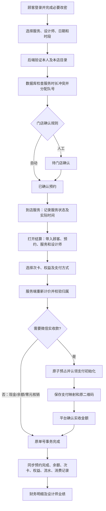

# 预约到结算闭环整改计划

用户授权整体梳理整改，保留上一轮诊断修改，统一由用户推送。全程不操作生产交易。

检查发现：结算先删草稿再创建存在断档；重复请求缺稳定业务标识；预约完成接口和结算同时累加消费/到店记录；结算原子函数未完成预约且到店记录使用收银员姓名；零价预约被前端 truthy 条件跳过；预约自动/人工确认模式仅在服务信息不完整时才读取；同预约不同结算缺数据库重复完成保护。

本轮范围：新建 031 迁移，原单号原子更新草稿并完成/预占次卡，事务内校验预约门店及客户、完成状态与取消状态，完成结算同时同步预约和服务设计师；前端保留预约上下文，稳定提交标识、防并发点击，不再先删草稿。服务完成只更新服务状态，不再提前记账或发消费奖励。预约目录/设计师按数据库补全，不信任传入显示字段。保留微信平台核验和服务端计价，纯次卡零元不创建微信支付单。

验收：隔离真实 SQL 覆盖草稿原号完成、次卡最后一次、日志故障回滚、相同请求重试、不同请求/同预约重复结算、预约已取消/越店、实际设计师、统计一次；HTTP 验证确认模式及权限，构建和启动通过。真实支付回调/微信真机/真实多连接不伪称已验收。

## 最终业务链路

“服务完成”与“财务结算完成”是不同节点。服务完成保留原操作，不再增加消费次数、金额或提前发消费奖励；一次正式结算才入账一次。预约字段暂沿用原状态模型，未新增“已服务待结算”状态，未结算单仍在未完成结算列表中继续处理。

## 已落实的改动与原因

| 环节 | 修复 | 对操作的影响 |
|---|---|---|
| 预约身份 | bookingAccess 统一验证员工或顾客会话及本店归属；取消/延时响应不能只凭顾客 ID | 登录后照常预约；越店、冒用被拒绝 |
| 档期信息 | 公开列表只含时段、设计师 ID、服务 ID、状态和时长；不含顾客姓名、电话、预约 ID 和备注 | 顾客仍能选设计师，不能浏览别人资料 |
| 创建预约 | 并行读取客户、目录及员工信息；人工确认始终按门店配置生效 | 客户端传入的伪造姓名、价格不再影响预约 |
| 档期争抢 | 031 触发器按服务时长检查重叠，门店行锁串行化新增/改期及队号分配 | 已被他人预约时提示换时段；90 分钟服务覆盖完整时长 |
| 前端档期 | H5/小程序使用时段区间及服务时长判断可用性 | 不再只比对是否恰好同一分钟 |
| 门店信息传达 | 预约管理切回窗口刷新，可见时每 20 秒静默刷新；同页请求不重叠；按当前门店取数 | 新预约更快显示，不需要持续手动刷新；不是实时推送 |
| 服务完成 | 仅更新服务状态，正式消费数据留给结算事务 | 避免服务完成一次、结算又累计一次 |
| 结算带入 | 恢复原单号、预约 ID、顾客、设计师、权益、改价、次卡和团购信息；零价预约可正常载入 | 从预约入口或未完成列表进入都保留原上下文 |
| 草稿替换 | 同一个 RPC 内原号更新；释放旧预占、验证、重新预占与完成同事务 | 不再先 DELETE 草稿，失败恢复原草稿 |
| 重复操作 | 页面即时防重入、稳定单号及请求摘要；数据库锁同预约防不同单号重复收费 | 原样重试已完成单返回原结果；改动已完成单被拒绝 |
| 核销/扣款 | 余额、次卡、权益、消费记录及预约完成在同事务内提交 | 一处失败整体回滚 |
| 设计师传达 | 收银人员和服务设计师分开；服务员工按本店有效员工核对姓名；到店记录取预约设计师 | 避免把收银员作为服务设计师 |
| 微信收款 | 原子标记支付初始化，避免并发生成多笔网关单；支付映射先于调用网关；保存原二维码供恢复 | 有支付映射的单不可删除/重开；零元核销不发起网关收款 |
| 报表明细 | 优先读取结算 JSON 明细，兼容旧 settlement_items | 防止新结算未写旧明细表时丢失服务/设计师业绩 |
| 错误传达 | 预约关键写入和结算接口失败直接抛错，不伪装为 mock 成功；保留上一轮草稿错误分类 | 店员能看到具体阻断原因 |

## 差异文件

- `migrations/031_booking_checkout_consistency.sql`：新增 settlements 的请求摘要/支付认领字段和 payments.code_url；覆盖三个结算 RPC；增加预约状态与档期触发器；显式收紧客户端执行权限。保留原 RPC 签名，迁移本身不执行业务扣款、不批量修复历史记录。
- `backend/middleware/bookingAccess.ts`：预约统一访问校验。
- `backend/routes/index.ts`、`backend/lib/settlementPricing.ts`：预约与结算路由、服务端计价、支付恢复、报表修复。
- `src/api.ts`、顾客预约页、门店预约管理页、结算页：错误传达、时长判断、上下文恢复与防重复提交。
- `mini-program/pages/booking/booking.js`：时段重叠判断、防重复点击、显示后端错误。上一轮个人中心与优惠券改动已在此前提交，本轮未重改。
- `scripts/upgrade-checkout.ts`：已有数据库只安装 031；`--check` 仅查元数据；`setup-db.ts` 新环境顺序扩展至 031；`verify-release.ts` 检查新增字段和触发器。
- 回归测试、本文与项目状态日志同步更新。上一轮未推送的草稿诊断改动一并保留。

## 验证证据与边界

- 使用 PGlite 真实 PostgreSQL 引擎、全合成数据测试事务；HTTP 回归使用实际部署入口和隔离数据替身，强制禁止访问外网。
- 已验证原草稿同号更新、最后一次次卡完成、核销日志故障整笔回滚、余额不足回滚、相同请求重试、已完成单改动拒绝、同预约第二单拒绝、取消预约/归属错误拒绝、异步初始化不可重复认领、收款中不可取消、实际设计师与消费次数、90 分钟重叠拒绝及相邻时段允许。
- 本地全套测试与构建结果以本轮交付状态日志为准；构建存在原有约 2 MB 主包警告，不是编译失败。
- 本地后端启动、`/api/health` 200、匿名预约 POST 401 已核对，不读取生产交易数据。
- 已用 `information_schema.columns` 只读核对生产相关表字段与类型，031 新字段尚未存在；未执行生产迁移、未查询顾客明细或密码、未发起扣款。
- 浏览器插件操作被自动审查拒绝，未给具体原因；没有完成浏览器交互/Network 或微信开发者工具/真机视觉验收。SQL 中 Promise 并发测试在单个隔离引擎队列中执行，不能替代真实 PostgreSQL 多连接竞争测试。

## 发布顺序（由用户执行）

1. 选择门店非营业或暂停收银的窗口，确保没有正在确认/回调中的支付；先保留数据库备份及当前部署版本。031–032 会替换函数/新增约束与恢复函数，避免营业中切换产生新旧版本交错。
2. 项目根目录运行 `npx tsx scripts/upgrade-checkout.ts --check`，只读核对结构。已有 025–031 的库只运行更新后的 `npx tsx scripts/upgrade-checkout.ts`（重跑031并安装032），不要运行密码初始化，也不必全量重跑 setup。
3. 看到 `[完成] 031–032 结构事务已提交` 后运行 `npx tsx scripts/verify-release.ts`，要求 `passed:true`、`issues:[]`。该工具仍不证明函数定义版本、真实支付和交易验收通过。
4. 用户统一 git add/commit/push；Vercel 确认新提交部署 Ready。需明确这是迁移之后才部署的新前后端，不以网页更新代替数据库升级。
5. 微信开发者工具重新编译本地小程序，更新体验版/发布包；网页推送不会自动发布小程序代码。
6. 用受控测试账号验收：新建预约→门店确认→设计师服务→从预约带入结算→现金、余额、纯次卡零元分别核对→关闭页恢复原单→查询次数/流水/报表。真实扣费测试须门店明确安排，本次助手未执行。

## 仍需后续完善，不能称为已解决

- 微信下单超时、支付映射保存失败、二维码过期或历史单未保存 code_url：当前优先阻断重复付款并保留订单，需门店对账。自动查单、关单、解除预占和补偿任务尚未实现，不能宣称所有网络故障都可自动恢复。
- 原有股东权益和推荐奖励仍是事务外异步操作，可靠投递、并发幂等及失败补偿尚待专项整改；核心结算原子性不等于奖励一定送达。
- 历史重复草稿、重复消费统计/到店记录、已完成但未结算的预约不做批量改写，需独立只读盘点和获授权后修复。
- 本轮聚焦预约到结算；其他队列、旧公开接口及全部报表时间口径没有完成全项目审计。门店 20 秒刷新也不等于短信/微信订阅消息已经接入。
